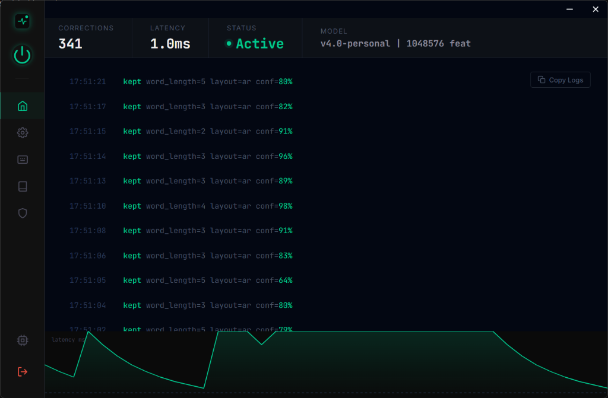

<div align="center">

<br />


<h1>Layvix Pro</h1>

<p><strong>AI-powered keyboard layout auto-corrector for Windows.</strong><br/>
Types in the wrong language? Layvix silently fixes it — in under 10ms.</p>

<br/>

[](https://github.com/SalehAlSalem/Layvix/releases/latest)
[](https://github.com/SalehAlSalem/Layvix/releases/latest)
[](https://python.org)
[](https://react.dev)
[](LICENSE)

<br/>



<br/><br/>

[**⬇ Download**](https://github.com/SalehAlSalem/Layvix/releases/latest) · [**📖 Docs**](docs/) · [**🐛 Report Bug**](https://github.com/SalehAlSalem/Layvix/issues)

</div>

---

## The Problem

You're typing fast in Arabic. But your keyboard was in English the whole time — and now you have a paragraph of gibberish like `اباؤاهؤفؤضي ؤاشثي`. You have to delete everything and retype.

**This happens hundreds of times a day to bilingual typists.** Layvix eliminates the problem entirely.

---

## What Layvix Does

Layvix runs invisibly in the background as a Windows tray service. The moment you finish typing a word, it decides — in under 10 milliseconds — whether the text is gibberish from a wrong keyboard layout. If it is, Layvix corrects it automatically and switches your layout.

No popups. No interruptions. It just works.

---

## Features

| Feature | Description |
|---|---|
| 🚀 **Sub-10ms Correction** | Raw OS-level keyboard hooks. Zero perceptible lag, even at 120+ WPM. |
| 🧠 **Local AI Engine** | An offline ML model (Scikit-Learn) trained on millions of words. Gets smarter from your own typing habits. |
| 🔒 **Security-Aware** | Automatically disables itself on password fields and full-screen applications. Your keystrokes never leave your machine. |
| ⚡ **Retroactive Correction** | Select gibberish text you already typed and press a hotkey — Layvix translates it instantly. |
| 🔄 **Auto-Updater** | Checks GitHub for new versions on startup. Downloads and hot-swaps the executable in the background — no reinstallation needed. |
| 🎨 **Modern Control Center** | A dark-themed React dashboard with live latency graphs, correction logs, hotkey customization, and app exclusion lists. |
| 🧩 **App Exclusions** | Block Layvix from running in specific apps (games, IDEs, etc.) with a click. |
| 📚 **Personal Dictionary** | Add custom word pairs. Layvix will always correct them exactly as you specify. |

---

## Architecture

Layvix is a full-stack desktop application built as a hybrid Python/React system:

```
┌─────────────────────────────────────────────────────────┐
│                  LayvixProPortable.exe                   │
│                                                         │
│  ┌──────────────────┐     ┌──────────────────────────┐  │
│  │   Core Engine    │     │    React Frontend (UI)   │  │
│  │   (Python)       │◄───►│    (Vite + TypeScript)   │  │
│  │                  │     │                          │  │
│  │  pynput hooks    │     │  FastAPI REST + SSE      │  │
│  │  AI Classifier   │     │  PyWebView (native win)  │  │
│  │  OS keyboard API │     │                          │  │
│  └──────────────────┘     └──────────────────────────┘  │
└─────────────────────────────────────────────────────────┘
```

**Tech Stack:**

- **Core:** Python 3.11 · `pynput` · `ctypes` · `win32api`
- **AI Model:** Scikit-Learn `PassiveAggressiveClassifier` · N-gram features · Online learning
- **Bridge API:** FastAPI · Uvicorn · Server-Sent Events (SSE) for real-time push
- **Frontend:** React 18 · TypeScript · Vite · Vanilla CSS
- **Packaging:** PyInstaller (single portable `.exe`, no installer required)

---

## Installation

Layvix is a **portable executable** — no installer, no admin rights, no dependencies.

1. Go to the [**Releases**](https://github.com/SalehAlSalem/Layvix/releases/latest) page
2. Download `LayvixProPortable.exe`
3. Run it — it appears silently in your **System Tray**
4. Right-click the tray icon → **Open Control Center**

> **Windows Defender Warning:** You may see a SmartScreen warning because the executable is not signed with a paid certificate. Click "More info" → "Run anyway". The full source code is available here for review.

---

## Building from Source

```bash
# 1. Clone
git clone https://github.com/SalehAlSalem/Layvix.git
cd Layvix

# 2. Python environment
python -m venv venv
venv\Scripts\activate
pip install -r requirements.txt

# 3. Frontend
cd frontend && npm install && npm run build && cd ..

# 4. Build portable executable (runs npm build + pyinstaller automatically)
python build_portable.py
# → Output: dist/LayvixProPortable.exe
```

---

## Project Structure

```
Layvix/
├── main.py              # Entry point — tray icon, window, startup
├── api.py               # FastAPI server — all REST + SSE endpoints
├── version.py           # Version string for auto-updater
├── core/
│   ├── core_engine.py   # Keyboard hook, word detection, correction logic
│   ├── keyboard_hook.py # Low-level pynput hook management
│   ├── updater.py       # GitHub release checker + installer
│   ├── app_scanner.py   # Active window & installed app detection
│   ├── security_guard.py# Secure input detection (passwords, UAC)
│   └── watchdog.py      # Process health monitoring
├── ai/
│   ├── ai_engine.py     # ML model: predict, train, save/load
│   └── learner.py       # Online learning from user corrections
├── utils/
│   ├── settings.py      # Persistent settings (JSON)
│   ├── logger.py        # Rotating log handler + UI event bus
│   ├── event_bus.py     # Async pub/sub for SSE streaming
│   └── user_dictionary.py # Custom correction pairs
├── frontend/            # React + TypeScript UI source
│   └── src/
│       ├── views/       # Dashboard, General, Hotkeys, Dictionary...
│       └── components/  # Sidebar, TitleBar, StatsBar, etc.
├── data/                # Icons, word lists, default assets
├── docs/                # Technical documentation
└── build_portable.py    # One-command build script
```

---

## Developer

<table>
  <tr>
    <td align="center">
      <a href="https://github.com/SalehAlSalem">
        <br/>
        <strong>Saleh Al Salem</strong>
      </a>
      <br/>
      <sub>Designer · Developer · Builder</sub>
    </td>
  </tr>
</table>

---

## License

MIT License — feel free to use, fork, and build on this project. See [LICENSE](LICENSE) for details.

---

<div align="center">
  <sub>Built with ❤️ for everyone who types in more than one language.</sub>
</div>
